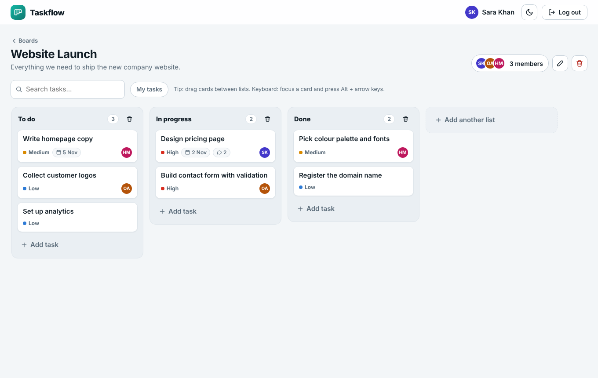
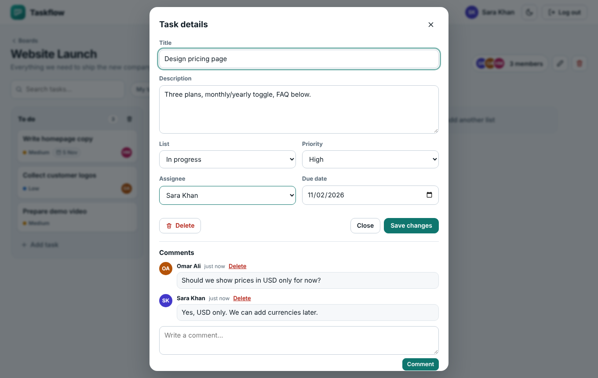
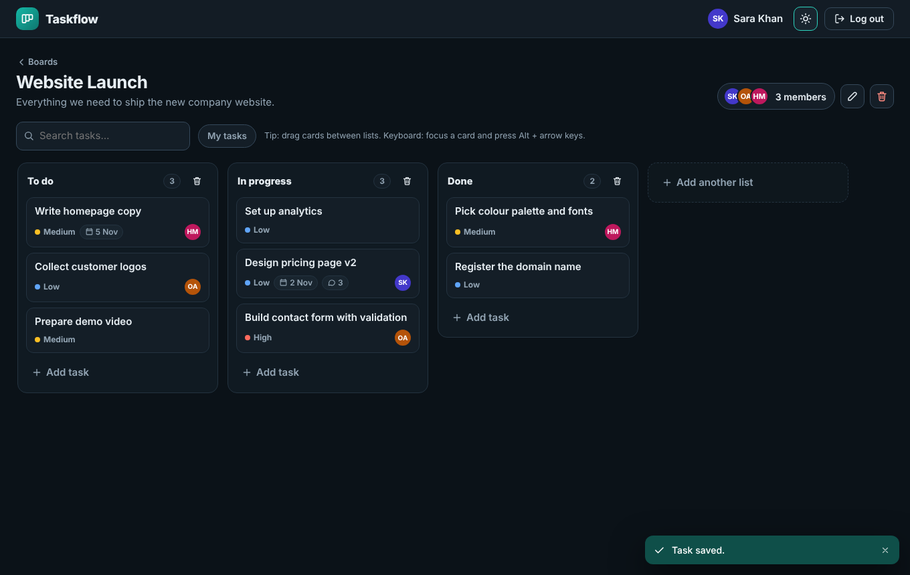
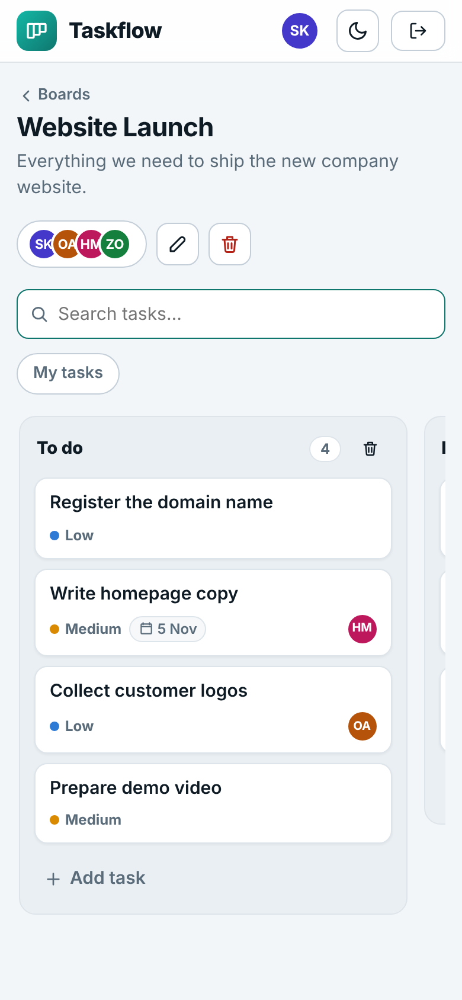
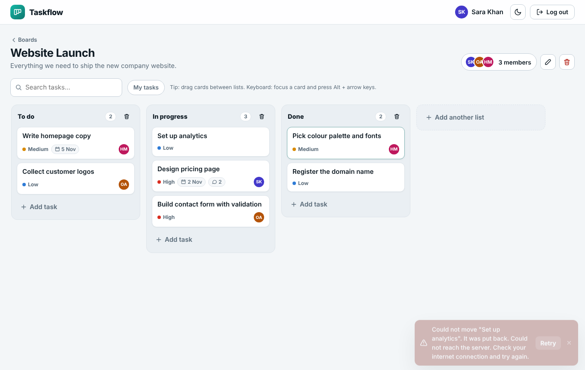
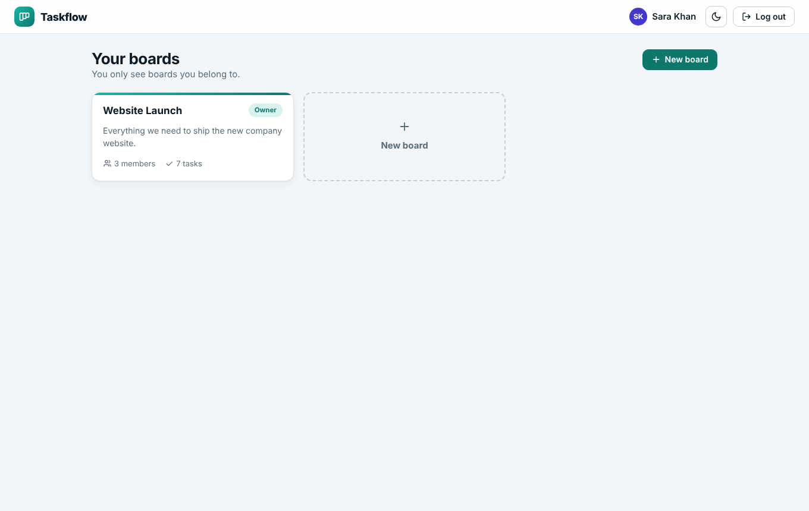
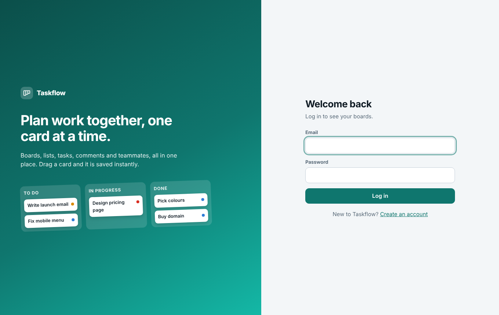

# Taskflow: Full-Stack Project Management App

A Kanban-style project management app with **drag-and-drop boards, tasks, comments and assignees**, user accounts, a REST API and a database. Users only see boards they belong to, and changes are saved **without page reloads**, with clear feedback when a request fails.

Built for the Varolline Web Developer internship (Task 7) with **Node.js + Express** on the back end and plain **HTML, CSS and JavaScript** on the front end.

**Author:** Mahin Saleem  
**Repository:** https://github.com/mahinsaleem001-debug/Web_Developer_Varolline_Task7



## Features

| Requirement | How it is delivered |
|---|---|
| Kanban boards with drag-and-drop | Lists (columns) and task cards; drag a card to another list or position. Keyboard alternative: focus a card, press **Alt + arrow keys**. A "List" dropdown in the task window also works on touch screens. |
| Tasks, comments, assignees | Each task has title, description, priority, due date, assignee (board members only) and a comment thread. |
| User accounts | Sign up / log in / log out. Passwords are hashed with bcrypt; sessions use a signed JWT in an `HttpOnly`, `SameSite=Strict` cookie. |
| Backend API + database | Express REST API (see [docs/API.md](docs/API.md)) and a JSON-file database with atomic writes. |
| Permissions | Boards have an **owner** and **members**. Non-members get `404` for everything on a board (even guessing ids reveals nothing). Only the owner can invite, rename and delete. |
| Save without reloads | All actions use `fetch()`. Drag-and-drop is **optimistic**: the card moves instantly and is put back if the server rejects it. A light poll (every 5 s) shows teammates' changes. |
| Failed requests | Clear messages: form errors under the field, a toast for network/server problems with a **Retry** button for moves, an offline banner, request timeouts, and session-expiry handling. |

### Extra features
Search and "My tasks" filter, overdue due-date highlighting, add/rename/delete lists, invite by email, leave board, light/dark theme, responsive layout, unsaved-changes warning, loading skeletons and empty states.

## Setup

You need **Node.js 18 or newer** ([nodejs.org](https://nodejs.org)).

```bash
npm install
npm start
```

Open **http://localhost:3000**, create an account, and make your first board.

Optional demo data (3 users and a sample board):

```bash
npm run seed
```
Then log in as `sara@example.com` (or `omar@example.com`, `hina@example.com`) with password `Demo1234`.

Run the tests (no extra setup):

```bash
npm test
```

> **Windows PowerShell:** if `npm` is blocked by the execution policy, use `npm.cmd install` and `npm.cmd start`.

### Configuration (optional)

Copy `.env.example` to `.env` to change `PORT`, `DATA_FILE` or `JWT_SECRET`. Without a `JWT_SECRET`, a random one is generated once and saved in `data/.secret`. Never commit real secrets.

## Project structure

```
server/
  index.js        Starts the server (loads config, secret and database file)
  app.js          Express app: auth, permissions, all API routes, security headers
  db.js           JSON-file database (in memory + atomic write to disk)
public/
  index.html      Page shell and dialogs
  css/style.css   Design tokens (light/dark), layout, components, responsive rules
  js/validate.js  Validation rules shared by browser AND server
  js/api.js       fetch wrapper: timeout, CSRF header, one error type
  js/ui.js        Helpers: element builder, icons, toasts, confirm dialog, avatars
  js/app.js       Screens: auth, boards, board, drag-and-drop, task window, members
scripts/seed.js   Optional demo data (uses the real API)
tests/            18 automated tests (API, permissions, validation)
docs/API.md       API documentation
```

## How it works

- **Data model:** `users`, `boards`, `members` (user + board + role), `columns`, `tasks`, `comments`. Task order is stored as a `position` number per list.
- **Permissions in one place:** every route resolves the board through the logged-in user's membership first, so a missing or foreign id always becomes `404`.
- **Moving a task:** `POST /api/tasks/:id/move { columnId, index }` removes the task from its list, inserts it at `index` in the destination and renumbers both lists to `1..n`. The browser runs the same algorithm locally for the instant update.
- **Sync:** every change bumps `board.version`; write responses return it in a header, so the browser knows whether the change was its own or a teammate's, and reloads only when needed.
- **Validation twice:** `public/js/validate.js` is used by the form (instant feedback) and by the server (the real check), so both always agree.

## Security

- Passwords hashed with **bcrypt**; login does the same work for unknown emails and gives one generic error (no account enumeration).
- Session cookie is `HttpOnly` + `SameSite=Strict`; writes require a custom header (**CSRF** defence); login/signup are **rate limited**.
- Strict **Content-Security-Policy** (no inline scripts or styles), `X-Frame-Options`, `nosniff`.
- All user text is rendered with `textContent` (no `innerHTML`), so stored text can never run as HTML.
- Request body size is limited; input is validated and trimmed on the server.

## Screenshots

| Task window | Dark theme | Mobile |
|---|---|---|
|  |  |  |

| Failed move (rolled back with Retry) | Boards | Login |
|---|---|---|
|  |  |  |

## Known limits

The JSON-file database suits a single server and small teams. For many users, replace `server/db.js` with PostgreSQL or SQLite; the routes would stay the same. Real-time updates use polling (5 s) instead of WebSockets. Touch screens use the "List" dropdown in the task window to move tasks.

## AI tool usage

Built with assistance from an AI tool (Claude). I reviewed, ran and tested all code and can explain each part.
